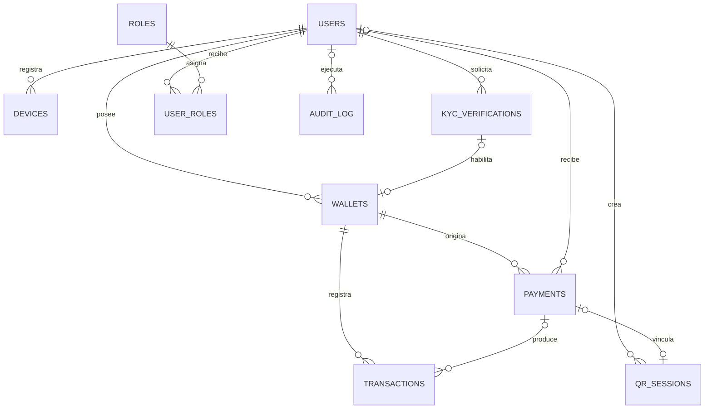

# Wallet Hackathon

Base del proyecto para demostrar de inicio a fin una wallet simple y segura: registro, pagos a personas o comercios y consulta clara del resultado de cada operacion.

## Objetivo del MVP

Una persona debe poder completar un pago de bajo monto y entender inmediatamente si fue realizado, rechazado, duplicado o si fallo y requiere una accion. Los agentes se incorporaran donde agreguen valor al flujo; su framework y arquitectura siguen pendientes de definicion.

## Stack tecnologico acordado

- **Backend:** Python con Flask.
- **Persistencia:** PostgreSQL.
- **Mensajeria:** RabbitMQ y Kafka, con Zookeeper para la coordinacion de Kafka.
- **Frontend:** Angular 21, TypeScript 5.9 y CSS propio.
- **Contenedores:** Docker y Docker Compose.

El stack queda registrado como contexto del proyecto. Las versiones, responsabilidades concretas de cada broker y configuraciones de servicios siguen pendientes de definicion.

## Epicas de contexto

1. **Registro y activacion del MVP de wallet**  
   Como usuario de smartphone que realiza transferencias diarias de bajo monto, quiero completar el onboarding de la wallet con un flujo guiado y señales claras de siguiente paso, para poder empezar a pagar sin abandonar el proceso.
2. **Confirmacion de pagos**  
   Como pagador, quiero completar una transferencia de bajo monto y recibir una confirmacion definitiva del resultado, para confiar en si el pago se realizo o no.
3. **Pagos QR para comercios**  
   Como pequeño comercio que cobra con QR, quiero ver el estado confiable de cada transaccion de cliente, para decidir correctamente cuando entregar el producto o servicio.

El detalle original de estas epicas esta en [docs/epics.md](./docs/epics.md).

## Servicios locales

```text
wallet-db        PostgreSQL en localhost:5432
wallet-services  Flask en localhost:5000; GET /health verifica el middleware
wallet-front     Angular servido por Nginx en localhost:5173
```

Copiar `.env.example` a `.env` y cambiar la contrasena local antes de iniciar. La contrasena de respaldo definida en Compose es solo para desarrollo local.

Con Podman, desde la carpeta `wallet-hackathon`:

```powershell
podman machine start
podman-compose up -d
```

El inicio predeterminado levanta solo `wallet-db`. Para iniciar Flask y Angular, ejecuta `podman-compose --profile app up --build -d`.

El middleware actual reenvia solicitudes al mock externo. PostgreSQL esta disponible en Compose, pero Flask aun no se conecta a esa base.

El comando directo `podman-compose` debe estar instalado para usar los comandos anteriores.

## Modelo de base de datos

El DDL de PostgreSQL está en [wallet-db/data.sql](./wallet-db/data.sql). Compose crea la base `wallet`; el archivo define las tablas e índices dentro de esa base. Actualmente no se monta como script de inicialización automática.

| Dominio | Tablas | Responsabilidad |
| --- | --- | --- |
| Identidad y acceso | `users`, `roles`, `user_roles`, `devices` | Usuarios, asignación de roles y dispositivos asociados. |
| Activación | `kyc_verifications`, `wallets` | Resultado de KYC, revisión humana y wallets habilitadas. |
| Pagos | `payments`, `transactions` | Solicitudes de pago y movimientos contables/reservados asociados. |
| QR | `qr_sessions` | Payload QR resuelto y vínculo opcional con el pago creado en W2. |
| Auditoría | `audit_log` | Actor, acción, entidad afectada, correlación y detalles del evento. |

Los IDs internos son UUID; los IDs recibidos de APIs se guardan como texto hasta confirmar sus tipos en el contrato. Los saldos de wallet no se duplican en una tabla: se calculan con los movimientos, donde `disponible = contable - reservado`. Los payloads y secretos sensibles no deben persistirse en auditoría.



## Estado

La base local de tres servicios esta configurada para desarrollo. Los contratos funcionales, las reglas de pago, el comportamiento de los agentes y los servicios de mensajeria siguen pendientes de definicion.
