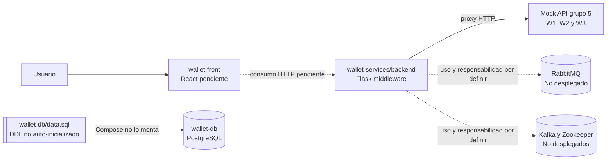
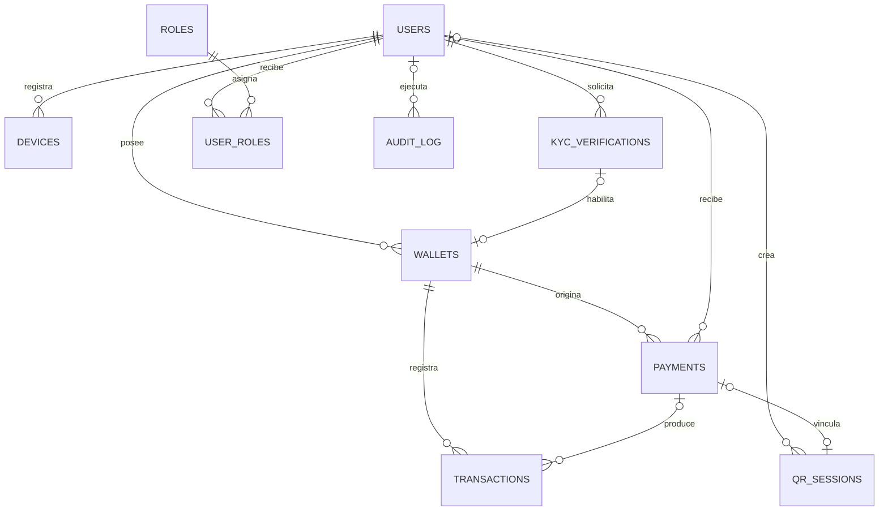

# Wallet Hackathon

Base del proyecto para demostrar de inicio a fin una wallet simple y segura: registro, pagos a personas o comercios y consulta clara del resultado de cada operacion.

## Objetivo del MVP

Una persona debe poder completar un pago de bajo monto y entender inmediatamente si fue realizado, rechazado, duplicado o si fallo y requiere una accion. Los agentes se incorporaran donde agreguen valor al flujo; su framework y arquitectura siguen pendientes de definicion.

## Stack tecnologico acordado

- **Backend:** Python con Flask.
- **Persistencia:** PostgreSQL.
- **Mensajeria:** RabbitMQ y Kafka, con Zookeeper para la coordinacion de Kafka.
- **Frontend:** Angular 21, TypeScript 5.9 y CSS propio.
- **Contenedores:** Docker y Docker Compose.

El stack queda registrado como contexto del proyecto. Las versiones, responsabilidades concretas de cada broker y configuraciones de servicios siguen pendientes de definicion.

## Arquitectura e infraestructura

La arquitectura objetivo separa la interfaz, el middleware API, la persistencia y los mocks externos. Las conexiones punteadas representan integraciones pendientes o componentes que aun no estan conectados por Compose.



| Componente | Infraestructura actual | Estado |
| --- | --- | --- |
| `wallet-db` | PostgreSQL 16 Alpine, puerto local `5432` y volumen `wallet-db-data` en Compose. | Servicio predeterminado. `wallet-db/data.sql` existe, pero no se ejecuta automáticamente. |
| `wallet-services/backend` | Aplicación Flask, Dockerfile propio y middleware hacia el mock del grupo 5. | Se construye y arranca por defecto con Compose. |
| `wallet-front` | React/Vite previsto. | Pendiente: no hay aplicación ni Dockerfile en la carpeta actual. |
| RabbitMQ, Kafka y Zookeeper | Parte del stack acordado. | No tienen servicios configurados en Compose; responsabilidades aún por definir. |

**Compose:** `wallet-services` se construye desde `wallet-services/backend`. `wallet-front` permanece en el perfil `app`, pero su ruta `wallet-front/Dockerfile` todavía no existe; por eso no puede iniciarse hasta completar su scaffold.

## Epicas de contexto

1. **Registro y activacion del MVP de wallet**  
   Como usuario de smartphone que realiza transferencias diarias de bajo monto, quiero completar el onboarding de la wallet con un flujo guiado y señales claras de siguiente paso, para poder empezar a pagar sin abandonar el proceso.
2. **Confirmacion de pagos**  
   Como pagador, quiero completar una transferencia de bajo monto y recibir una confirmacion definitiva del resultado, para confiar en si el pago se realizo o no.
3. **Pagos QR para comercios**  
   Como pequeño comercio que cobra con QR, quiero ver el estado confiable de cada transaccion de cliente, para decidir correctamente cuando entregar el producto o servicio.

El detalle original de estas epicas esta en [docs/epics.md](./docs/epics.md).

## Agentes por rol

- **Arquitectura:** [Architect](./agentes/architect.agent.md) analiza impacto y define límites técnicos incrementales.
- **Frontend:** [Frontend Wallet Developer](./agentes/frontend.agent.md) implementa cambios aprobados de la interfaz Wallet.
- **Producto:** [PM-PO](./agentes/pm-po.agent.md) transforma necesidades aprobadas en historias, criterios y specs.
- **QE - Diseño de casos:** [QE Test Case Designer](./agentes/qe-test-case-designer.agent.md) diseña casos BDD trazables para backend y frontend.
- **QE - Estrategia:** [QE Test Strategy](./agentes/qe-test-strategy.agent.md) define el enfoque y la trazabilidad de pruebas priorizados por riesgo.

## Especificaciones

### Arquitectura

- [Visibilidad del estado de pagos QR para comercios](./specs/merchant-qr-payment-status.md)
- [Registro y activación del MVP de wallet](./specs/onboarding.md)
- [Confirmación de pagos de bajo monto](./specs/payer-low-contact-payment.md)

### Desarrollo

- [Implementación de OnBoarding](./specs/onboarding-implementation.md)
- [Implementación de pagos de bajo monto](./specs/payer-low-contact-payment-implementation.md)
- [Implementación de visibilidad de pagos QR para comercios](./specs/merchant-qr-payment-status-implementation.md)

## Servicios locales

```text
wallet-db        PostgreSQL en localhost:5432
<<<<<<< HEAD
wallet-services  Flask middleware previsto en localhost:5000
wallet-front     React/Vite previsto en localhost:5173
=======
wallet-services  Flask en localhost:5000; GET /health verifica el middleware
wallet-front     Angular servido por Nginx en localhost:5173
>>>>>>> 7441c56af21d5d8f0a86309f377c4c4a0d5be5d1
```

Copiar `.env.example` a `.env` y cambiar la contrasena local antes de iniciar. La contrasena de respaldo definida en Compose es solo para desarrollo local.

Con Podman, desde la carpeta `wallet-hackathon`:

```powershell
podman machine start
<<<<<<< HEAD
podman compose up --build -d
```

El inicio predeterminado levanta `wallet-db` y `wallet-services`. `wallet-front` sigue pendiente; el perfil `app` no se puede iniciar hasta crear su Dockerfile y aplicación.
=======
podman-compose up -d
```

El inicio predeterminado levanta solo `wallet-db`. Para iniciar Flask y Angular, ejecuta `podman-compose --profile app up --build -d`.
>>>>>>> 7441c56af21d5d8f0a86309f377c4c4a0d5be5d1

El middleware actual reenvia solicitudes al mock externo. PostgreSQL esta disponible en Compose, pero Flask aun no se conecta a esa base.

El comando directo `podman-compose` debe estar instalado para usar los comandos anteriores.

## API de wallet-services

El contrato OpenAPI local esta en [wallet-services/api/contrato-wallet.json](./wallet-services/api/contrato-wallet.json). Sus rutas locales se implementan en [wallet-services/backend/app.py](./wallet-services/backend/app.py) y reenvian las solicitudes al mock del grupo 5, cuya base por defecto es `https://bcp-wallet-mock.yefri.workers.dev/groups/5`.

| Grupo | Metodo | Ruta del contrato local | Endpoint upstream consumido |
| --- | --- | --- | --- |
| W1 - Registro y activacion | POST | `/crear-wallet` | `POST /kyc/verifications` |
| W1 - Registro y activacion | GET | `/consultar-kyc/{verification_id}` | `GET /kyc/verifications/{id}` |
| W1 - Registro y activacion | POST | `/resolver-decision/{verification_id}` | `POST /kyc/verifications/{id}/decision` |
| W1 - Registro y activacion | GET | `/consulta-estado-saldos/{wallet_id}` | `GET /wallets/{id}` |
| W2 - Pago a contacto | GET | `/payments?walletId={walletId}` | `GET /payments?walletId={walletId}` |
| W2 - Pago a contacto | POST | `/payments` | `POST /payments` |
| W2 - Pago a contacto | GET | `/payments/{payment_id}` | `GET /payments/{id}` |
| W2 - Pago a contacto | GET | `/payments/{payment_id}/receipt` | `GET /payments/{id}/receipt` |
| W2 - Pago a contacto | GET | `/provider/payments/{payment_id}` | `GET /provider/payments/{id}` |
| W3 - Pago QR comercio | POST | `/qrs` | `POST /qrs` |
| W3 - Pago QR comercio | POST | `/qrs/resolve` | `POST /qrs/resolve` |

El contrato local define las rutas y metodos de la tabla; la columna upstream muestra las rutas que el backend reenvia. Para `POST /payments`, el contrato exige el header `Idempotency-Key`, que el middleware reenvia.

> **Estado de Compose:** `wallet-services` se construye desde `wallet-services/backend` y expone las rutas anteriores en `localhost:5000` al iniciar Compose.

## Modelo de base de datos

El DDL de PostgreSQL está en [wallet-db/data.sql](./wallet-db/data.sql). Compose crea la base `wallet`; el archivo define las tablas e índices dentro de esa base. Actualmente no se monta como script de inicialización automática.

| Dominio | Tablas | Responsabilidad |
| --- | --- | --- |
| Identidad y acceso | `users`, `roles`, `user_roles`, `devices` | Usuarios, asignación de roles y dispositivos asociados. |
| Activación | `kyc_verifications`, `wallets` | Resultado de KYC, revisión humana y wallets habilitadas. |
| Pagos | `payments`, `transactions` | Solicitudes de pago y movimientos contables/reservados asociados. |
| QR | `qr_sessions` | Payload QR resuelto y vínculo opcional con el pago creado en W2. |
| Auditoría | `audit_log` | Actor, acción, entidad afectada, correlación y detalles del evento. |

Los IDs internos son UUID; los IDs recibidos de APIs se guardan como texto hasta confirmar sus tipos en el contrato. Los saldos de wallet no se duplican en una tabla: se calculan con los movimientos, donde `disponible = contable - reservado`. Los payloads y secretos sensibles no deben persistirse en auditoría.



## Estado

PostgreSQL y el middleware Flask estan configurados para desarrollo local. El frontend React y la integracion de mensajeria siguen pendientes. Los contratos funcionales y las reglas de pago se documentan en las especificaciones enlazadas arriba.
